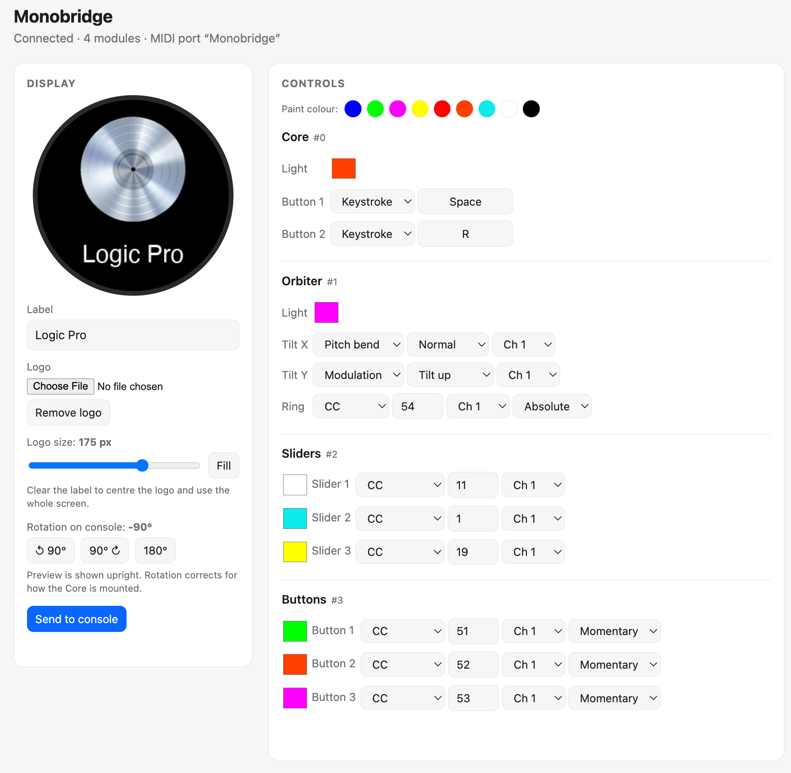

# Monobridge

**Keep your Monogram Creative Console working, now that Monogram's software is gone.**

Monobridge is a small, free Mac app that talks to the Monogram console directly over USB. You don't need Monogram Creator, an account or a license server. It turns your dials, sliders, buttons and Orbiter into MIDI, keystrokes and scrolling. It also sets the module colours and the logo on the Core's screen.

*Unofficial community project, not affiliated with or endorsed by Monogram or Palette Gear.*



*The control panel with a Logic Pro setup: Core buttons as Space/Record, Orbiter as pitch bend and modulation, and coloured sliders and buttons.*

---

## What it does

- **Finds your modules automatically.** It knows how they're chained, and it updates live when you snap a module on or off.
- **Sends MIDI on a virtual port called "Monobridge"** that any app can use (Logic, Ableton, Cubase, MIDI2LR for Lightroom and others):
  - **Buttons:** CC (momentary or toggle), Note, Program change, or a **keystroke** (any key combination, e.g. Space, ⌘⇧R)
  - **Sliders:** CC, Pitch bend, or Aftertouch
  - **Orbiter tilt:** **Pitch bend** (springs back to centre), **Modulation** (CC 1), CC, Aftertouch, or scrolling
  - **Orbiter ring and dials:** relative or absolute CC, or scrolling
  - Any CC or note number and any MIDI channel, per control
- **Sets LED colours** for every module, and for each button or slider on the 3-control modules.
- **Puts your own logo and label on the Core's display**, with size and rotation controls.
- **Imports your old Monogram profiles** (`.monogram` files), including colours, logo, MIDI assignments and keystrokes.
- Runs quietly in the menu bar, reconnects by itself after unplugging or sleep, and can start at login.

Tested with Logic Pro on an Apple Silicon Mac, with a Core, an Orbiter, 3-slider and 3-button modules. The single button, slider and dial modules and the 3-dial module are supported from the protocol but **untested**, so reports are very welcome.

## Install

1. Download **`Monobridge-mac-AppleSilicon.zip`** from the [Releases](../../releases) page and unzip it.
2. Drag **Monobridge** into your **Applications** folder.
3. Open it. The first time, macOS will block it because it isn't from an identified developer; this is a free hobby project without a paid Apple certificate.
   - Click **Done** on the warning (don't move it to the Bin).
   - Open **System Settings → Privacy & Security**, scroll down, and click **Open Anyway** next to Monobridge.
   - Confirm with your password or Touch ID. You only need to do this once.
4. **Quit Monogram Creator** (and Monogram Service if it's in the menu bar). Only one app can use the console at a time.

A slider-and-dial icon appears in your menu bar. It's **solid** when the console is connected and **faded** when it's waiting.

> Apple Silicon Macs only (M1 or later). Intel Mac users can run the Python version, described below.

## Using it

Click the menu-bar icon:

| Menu item | What it does |
|---|---|
| **Open Control Panel** | Opens the settings page in your browser (`http://localhost:8765`). |
| **Import Monogram Profile…** | Loads an old `.monogram` profile, including its colours, logo, MIDI and keystrokes. |
| **Allow Keystrokes & Scrolling…** | Needed only for keystroke and scroll actions. Switch on **Monobridge** in Privacy & Security → Accessibility, then reopen the app. MIDI works without this. |
| **Start at Login** | Starts Monobridge automatically when you log in. |
| **Show Log** | Shows what Monobridge is doing, which is useful when reporting problems. |

In the **control panel**:

- **Display:** set a label and logo, the logo size (**Fill** makes it as large as possible), and the rotation, then press **Send to console**.
- **Controls:** each module is listed with its colour boxes and settings. Changes are saved and applied instantly. To paint several lights quickly, pick a colour swatch at the top and click colour boxes.

In your DAW, enable the MIDI input **Monobridge**. In Logic, that's **Settings → MIDI → Inputs**; then use **Learn** to map controls.

**Tip for Logic:** set Orbiter **Tilt X → Pitch bend** and **Tilt Y → Modulation** for a classic synth joystick.

## Troubleshooting

- **The icon stays faded.** Click it and read the status line. "Console busy" means another program, usually Monogram Creator, is holding the console; quit it. "Waiting for the console" means it can't see the console; try a different USB cable or port.
- **Keystrokes do nothing.** Allow Monobridge under System Settings → Privacy & Security → Accessibility. After installing an update you may need to remove it there with **–** and add it again.
- **Scrolling scrolls the wrong window.** Scrolling always goes to the window under the mouse pointer, just like a mouse wheel. For Logic, MIDI or keystrokes are more reliable.
- **Please report bugs** in [Issues](../../issues), with the log (menu → Show Log) and, if you can, the output of the `monitor` command below.

## Python version (Intel Macs, developers)

```bash
pip3 install pyserial msgpack python-rtmidi pillow
python3 monobridge.py ports      # check the console is visible
python3 monobridge.py monitor    # show raw data from the console
python3 monobridge.py run        # run the bridge and control panel
python3 monobridge.py run -p "My Profile.monogram"   # import a profile
```

To build the app yourself, run `./build_app.sh`.

## How it works

The Monogram Core is a USB serial device (VID `0483`, PID `a2c5`) that speaks MessagePack messages in simple framed packets. [PROTOCOL.md](PROTOCOL.md) documents everything learned so far, for anyone who wants to build on it.

## License

MIT. See [LICENSE](LICENSE). Monogram is a trademark of its respective owner; it's used here only to describe compatibility.
